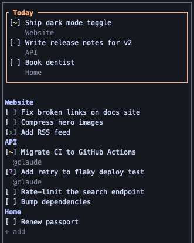

# herdr-feedr

The feed rack for your herd — a markdown-backed to-do sidebar for [Herdr](https://herdr.dev), shared between you and your coding agents. You keep a plain to-do list; agents pull work from it, add their own, and report back — all through one file you can always open in any editor.



- **One markdown file** (`~/.config/herdr-feedr/feed.md` by default): GFM checkboxes, `##` sections, an indented body per item for agent context. Hand edits are respected.
- **A sidebar in every tab**: click a checkbox to advance `[ ]` → `[~]` → `[x]`, click a title to edit, mark up to three items as **Today**, select text to copy.
- **Agents work the same list** through the `feedr` CLI and a shipped skill: they list, claim (`@agent(...)`), add, and hand items back for review (`[?]`).
- **Safe to share**: every write is locked and atomic, so you and your agents never lose each other's edits.

The design is in [docs/SPEC.md](docs/SPEC.md).

## Install

**Requirements:** [herdr](https://herdr.dev) 0.9.0+ on macOS or Linux, and a [Rust toolchain](https://rustup.rs). v1 builds from source; prebuilt binaries are tracked in [#42](https://github.com/Adroz/herdr-feedr/issues/42). Windows isn't supported yet.

```sh
herdr plugin install Adroz/herdr-feedr
```

herdr clones the repo, runs `scripts/build.sh` (`cargo build --release`), and registers the `feedr-sidebar` pane plus two actions: `open-feedr` (open or focus the sidebar, docked to the configured side, left by default) and `toggle-feedr` (close if open, else open). Then install the agent skill (see [Teach your agent](#teach-your-agent) below).

Outside herdr, `cargo install --path .` gives you the `feedr` CLI, and `feedr sidebar` runs the sidebar in any terminal.

### Local development

Link this working tree instead of a published release:

```sh
herdr plugin link /path/to/herdr-feedr-sidebar
```

Rebuild loop while iterating:

1. Edit the code.
2. `cargo build --release` (or re-run `herdr plugin link <path>`, which re-runs `scripts/build.sh`).
3. Restart the sidebars so they pick up the new binary — herdr doesn't hot-reload a running pane's process. `bash scripts/reload-feedr.sh` does steps 2–3 for every open sidebar in every tab (`--dry-run` to preview, `--tab <id>` for one tab); or close and reopen a single one by hand (`toggle-feedr` twice).

`herdr plugin list` shows whether herdr-feedr loaded, with its pane and both actions.

### Render snapshots

Sidebar layouts (Today panel, list, edit modal, Done archive, file view) are pinned as [`insta`](https://insta.rs) text snapshots in `src/tui/snapshots/`, so a layout change shows up as a reviewable diff. When `cargo test` fails on a snapshot:

1. `cargo install cargo-insta` (once).
2. `cargo insta review` — read each diff. Accept it only if the change is one you meant to make; otherwise fix the code.
3. Commit the updated `.snap` files with the change that caused them. Never commit `.snap.new` files.

A new snapshot test fails until its first `.snap` is accepted the same way. CI never writes snapshots, so an unreviewed one fails the build there. Snapshots are text only — colour and style are asserted in ordinary tests.

### Bind keys

Bind the actions to keys in `~/.config/herdr/config.toml` (`type = "plugin_action"`, `command = "<plugin-id>.<action-id>"` — the same shape herdr-file-viewer uses for its own binding):

```toml
[[keys.command]]
key = "prefix+t"
type = "plugin_action"
command = "herdr-feedr.open-feedr"

[[keys.command]]
key = "prefix+shift+t"
type = "plugin_action"
command = "herdr-feedr.toggle-feedr"
```

(Pick keys that don't collide with existing bindings — check `~/.config/herdr/config.toml` for what's already taken.)

## Teach your agent

The feed is only half the point: agents work items off it. herdr-feedr ships a skill at
`skills/herdr-feedr/SKILL.md` that teaches them the protocol — claim before working, finish by
provenance, never edit the feed file directly.

herdr has no skill-delivery mechanism of its own (a plugin's `skills/` directory is inert
convention), so installing the skill is one explicit step:

```sh
npx skills add Adroz/herdr-feedr -g   # agent-neutral; needs Node
feedr skill install                   # same thing, no Node required
```

Either lands the canonical copy in `~/.agents/skills/herdr-feedr/` and links
`~/.claude/skills/herdr-feedr` at it. Those two paths are the only places `feedr skill install`
ever writes.

```sh
feedr skill status    # where it's installed, and whether it matches this binary
```

`scripts/build.sh` runs `feedr skill install --refresh-only`, which refreshes copies that
already exist and never creates one — so `herdr plugin install` updates an installed skill
without planting files in your home directory unasked.

For runners with no skill support, paste the skill's "golden rule" and "Finishing" sections into
your project's `AGENTS.md`.

## Agent identity

`feedr claim` stamps the claiming agent's ref so the sidebar can jump to its pane. The ref
resolves from `--agent`, then `FEEDR_AGENT`, then `herdr pane current`, then
`CLAUDE_CODE_SESSION_ID` — the last two carry the same session id, so claims work inside and
outside herdr:

```sh
feedr whoami          # claude:2f62ad27-… (from herdr pane current)
```

It never claims untagged: an unlinked claim is a dead link, so unresolvable identity fails loudly.

A claim isn't permanent. `feedr unclaim <item>` clears the tag and puts the item back to `[ ]`;
agents may release only their own claims, while you (and the sidebar's `[ Release ]` button, shown
on a claimed item's edit modal) may release anyone's. In the sidebar, an `@agent` sub-line carries
a live marker when herdr can see that session — no marker means "not visible", never "dead".

## Copying text

In the edit modal and the read-only Done archive and file views, dragging over text copies it on release; a double-click copies the word under the pointer and a triple-click the whole line. Ctrl+C copies the current selection again. For anything else on screen, including the sidebar list, use herdr copy mode: `prefix+[`, then `v` to select and `y` to copy.
